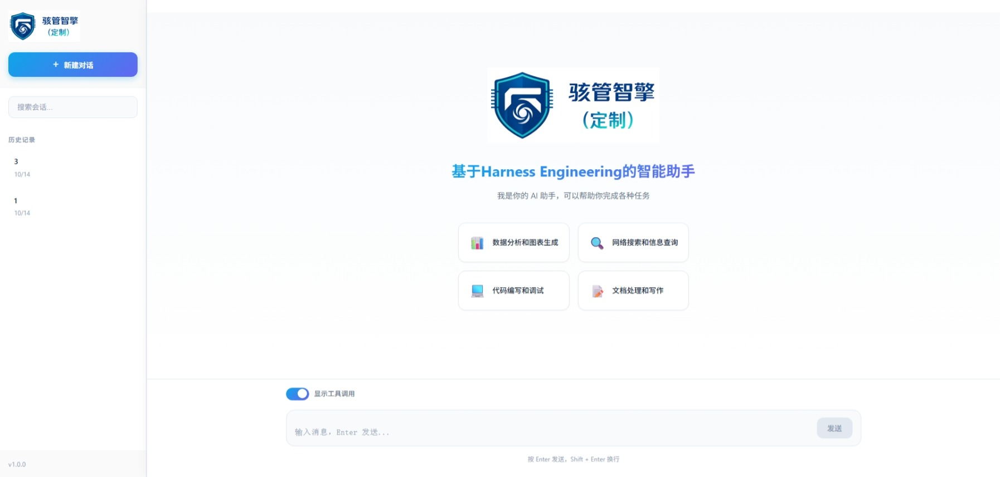

# AgentToMotorcycleERP — 摩托车零部件采购 ERP 与 AI 采购智能体


本仓库是一个**「传统 ERP 后端 + AI 采购智能体」**的完整示例工程：用 Spring Boot 实现摩托车零部件采购的业务系统（供应商 / 零部件 / 采购订单 / 库存 / 客户 / 物流 / 统计），再在其之上叠加一个基于 DeepAgents + LangGraph 的 AI 采购助手，让用户用自然语言完成比价分析、行情调研、订单创建与修改。

```
用户  ──▶  Vue 3 聊天前端 ──▶  FastAPI (SSE 流式) ──▶  DeepAgent (LangGraph)
                                                          │
                                          ┌───────────────┼────────────────┐
                                          ▼               ▼                ▼
                                    ERP MCP 桥接     可视化 MCP        沙箱 (WSL/OpenSandbox)
                                          │          (26 种图表)      Python 数据分析
                                          ▼
                                  Spring Boot ERP 后端 ──▶ MySQL
```

---

## 一、仓库包含什么

仓库根目录下有两个相互独立、可分别运行、又通过 HTTP/MCP 协作的子项目。

| 目录 | 名称 | 角色 | 技术栈 |
|------|------|------|--------|
| [`MotorcyclePartsProcurementSystem/`](MotorcyclePartsProcurementSystem/) | 摩托车零部件采购管理系统 | 业务后端（系统 of record），提供 ERP 全部 REST 接口与 MySQL 数据 | Java 17 · Spring Boot 3.1.10 · MyBatis-Plus 3.5.3.1 · MySQL 8 · springdoc-openapi 2.0.2 |
| [`ERP_OPENCLAW/`](ERP_OPENCLAW/) | ERP 采购智能助手（OpenClaw） | AI 助手：对话编排、子 Agent 分工、MCP 工具调用、沙箱分析、前端聊天界面 | Python 3.10+ · DeepAgents · LangGraph 1.x · FastAPI · FastMCP · MongoDB · Vue 3 + Vite 5 |

**为什么拆成两个工程**：ERP 后端负责"数据正确"（事务、逻辑删除、统一响应契约），AI 助手负责"交互智能"（理解需求、多步分析、生成报告）。两者只通过 REST API 耦合，AI 侧永远不直连 MySQL——所有业务数据都经由 MCP 桥接调用 Java 接口获取，避免出现两套数据访问逻辑。

> 需要注意：ERP 后端的**自动建表不含外键**（只有手动执行 `docs/database_schema.sql` 时才建），因此"数据正确"目前主要靠应用层校验而非数据库约束。详见 [DATABASE.md](docs/DATABASE.md) §1.6。

> 仓库根目录还存在两处**非工程代码**内容：[`MotorcyclePartsProcurementSystem/ecommerce-demo/`](MotorcyclePartsProcurementSystem/ecommerce-demo/) 为纯静态前端演示页（不连后端，仅作 UI 参考），[`ERP_OPENCLAW/src/download/`](ERP_OPENCLAW/src/download/) 为智能体生成的历史分析报告样例。
>
> 另有两个易被误解的文件，均在 `ERP_OPENCLAW/` 下：`mcp工具列表.txt` 与 **`motorparts_db.sql`** —— 后者虽然叫 `.sql`，但**不是 SQL 文件也不是数据库导出**，两者内容同源，都是远程可视化 MCP 那 27 个 `generate_*` 工具的 Python `repr` 快照（含完整 JSON Schema），属诊断留存。

---

## 二、核心业务能力（ERP 后端）

| 模块 | 能力 |
|------|------|
| 供应商管理 | 档案 CRUD、按名称/状态/信用评级检索、合作状态与信用评级变更（A/B/C/D） |
| 零部件管理 | 档案 CRUD、按名称/分类/供应商检索、采购单价调整、按供应商反查零部件 |
| 采购订单 | 创建（自动汇总金额）、整体更新、逻辑删除、分页多条件查询、状态流转（1 待审核 → 2 已审核 → 3 采购中 → 4 已入库 / 5 已取消）、订单明细按零部件名 + 时间范围联表搜索 |
| 库存管理 | 入库/出库、安全库存维护、库存预警列表（当前库存 ≤ 安全库存）、库存盘点汇总 |
| 客户管理 | 档案 CRUD、客户类型（经销商/零售店/个人）、折扣等级、类型与折扣变更 |
| 物流管理 | 物流单 CRUD、按订单查询、状态更新、发货信息与收货信息登记 |
| 统计分析 | 仪表盘汇总、供应商分布、零部件分类与价格区间分布、库存状态分布、月度采购趋势 |

接口统一返回 `Result<T>`（`code` / `message` / `data` / `timestamp`），分页返回 `PageResult<T>`（`current` / `size` / `total` / `pages` / `records`）。共 **54 个 REST 端点**，覆盖 7 个控制器。

> 系统当前**没有认证与授权层**：无登录接口、无 Spring Security、无拦截器，所有端点匿名可访问（含下单与改库存）。定位为内部演示/教学系统，不可直接暴露公网。

详见 [API 接口文档](MotorcyclePartsProcurementSystem/docs/API_DOCUMENTATION.md) 与本文档集的 [API 参考](docs/API_REFERENCE.md)。

---

## 三、核心 AI 能力（ERP_OPENCLAW）

- **主从 Agent 编排**：主 Agent 只做"调度与对话"，把分析类任务委派给 `procurement-analyst`，把订单类任务委派给 `procurement-order`；子 Agent 定义在 YAML 中，新增/调整无需改代码。
- **MCP 工具桥接**：本地 FastMCP 服务把 Java REST 接口封装为 `supplier_query`、`part_query`、`part_search`、`part_by_supplier`、`order_search_details`、`order_create`、`order_update`、`inventory_warning` 共 8 个工具；远程可视化 MCP 提供 26 种图表，被合并为单一入口 `generate_visualization`。
- **代码执行沙箱**：`local`（本机 WSL 发行版）或 `opensandbox`（独立部署）两种模式，沙箱内预置 `numpy/pandas/matplotlib/requests/beautifulsoup4`，Agent 可写 Python 做真实数据分析。
- **双层 Human-in-the-Loop**：
  1. 数据补充中断 —— `request_order_info` 在订单字段缺失时暂停，等用户用自由文本补齐；
  2. 审批中断 —— `order_create` / `order_update` 执行前暂停，等用户 `approve` / `reject`。
- **长期记忆**：`/memories/{user_id}/preferences.md` 保存输出格式、图表类型、货币、语言偏好；`recent_suppliers` / `recent_queries` 由 `MemoryUpdateMiddleware` 在每轮 ERP 对话后自动抽取与合并。
- **技能（Skills）体系**：预置技能由 `SkillsSyncMiddleware` 从本地同步进沙箱，用户新增技能经测试后由 `assign_skill` 持久化到 StoreBackend，会话开始时由 `UserSkillsRestoreMiddleware` 自动恢复。
- **上下文治理**：工具结果超 20k tokens 自动 offload 到文件系统；上下文达 85% 自动摘要，另提供 `compact_conversation` 工具供 Agent 主动压缩。

---

## 四、快速启动

最小可用路径（Windows 推荐 `SANDBOX_MODE=local`，无需部署 OpenSandbox）：

```powershell
# 1) 基础依赖：JDK 17、Maven、MySQL 8、MongoDB、Node.js 18+、Python 3.10+、WSL2（沙箱模式 local 需要）

# 2) 启动 ERP 后端（首次启动自动建库建表并插入模拟数据）
cd MotorcyclePartsProcurementSystem
mvn spring-boot:run               # → http://localhost:8080
                                  #   Swagger: /swagger-ui/index.html · OpenAPI: /v3/api-docs

# 3) 启动 ERP MCP 桥接（把 Java REST 暴露为 MCP 工具）
cd ..\ERP_OPENCLAW
copy .env.example .env            # 填入 DEEPSEEK_API_KEY 等
$env:PYTHONPATH = "$PWD\src"      # 必需：代码使用顶层包名导入
python -m mcp_server.server_main  # → http://127.0.0.1:8000/mcp

# 4) 启动 AI 助手后端 + 前端（一条命令拉起两个进程）
python start_web.py               # 后端 :8090  /  前端 :3000
```

访问 <http://localhost:3000> 开始对话。Agent 首次初始化需要 30–60 秒（创建沙箱、装载技能、预装 Python 依赖）。

> MongoDB 需在启动第 4 步**之前**就绪（AI 后端启动时会连接它）。

完整的依赖版本、环境变量、沙箱与数据库准备步骤见 [安装与部署](docs/SETUP_AND_DEPLOYMENT.md)。

---

## 五、文档索引

文档集中在根目录 [`docs/`](docs/)，与原有两个子项目的既有文档并存（原文档保留未改动）。

| 文档 | 内容 | 适合谁看 |
|------|------|----------|
| [ARCHITECTURE.md](docs/ARCHITECTURE.md) | 系统架构、模块划分、请求全链路、Agent 初始化流水线、关键设计决策与权衡 | 架构师、新加入的开发者 |
| [SETUP_AND_DEPLOYMENT.md](docs/SETUP_AND_DEPLOYMENT.md) | 环境要求、依赖安装、配置项全量说明、两种沙箱模式部署、启动/停止、常见故障排查 | 需要把项目跑起来的人 |
| [API_REFERENCE.md](docs/API_REFERENCE.md) | 全部 54 个 ERP REST 端点 + FastAPI 对话接口 + MCP 工具清单 + SSE 事件协议 | 前端、Agent 开发者、接口联调 |
| [DATABASE.md](docs/DATABASE.md) | 8 张业务表结构、两种建表方式的差异、索引与视图、枚举取值、模拟数据生成规则、MongoDB 集合 | 后端、DBA |
| [AI_AGENT.md](docs/AI_AGENT.md) | DeepAgent 架构细节、中间件栈、子 Agent、技能、记忆、HITL 中断恢复、扩展指南 | AI 应用开发者 |
| [FRONTEND.md](docs/FRONTEND.md) | Vue 3 聊天界面（组件、状态、SSE 消费）与 ecommerce-demo 静态演示页 | 前端开发者 |
| [DEVELOPMENT_GUIDE.md](docs/DEVELOPMENT_GUIDE.md) | 本地开发工作流、代码约定、测试脚本、调试技巧、已知问题与技术债 | 所有贡献者 |

子项目既有文档（内容仍然准确，但部分版本号已过时，详见下文"已知不一致"）：

- [MotorcyclePartsProcurementSystem/README.md](MotorcyclePartsProcurementSystem/README.md)
- [MotorcyclePartsProcurementSystem/docs/API_DOCUMENTATION.md](MotorcyclePartsProcurementSystem/docs/API_DOCUMENTATION.md) — 63 KB 的逐端点详细文档
- [MotorcyclePartsProcurementSystem/docs/database_schema.sql](MotorcyclePartsProcurementSystem/docs/database_schema.sql) — 权威建表 SQL
- [MotorcyclePartsProcurementSystem/docs/数据来源说明.txt](MotorcyclePartsProcurementSystem/docs/数据来源说明.txt) — 模拟数据来源与免责声明
- [ERP_OPENCLAW/README.md](ERP_OPENCLAW/README.md) — 仍是 LangGraph 官方模板文档，**已不反映实际实现**

---

## 六、已知不一致（阅读时请注意）

这些是代码仓库中实际存在的陈述冲突，本文档集以**代码为准**记录（已逐项核实）：

| 位置 | 陈述 | 实际情况 |
|------|------|----------|
| `MotorcyclePartsProcurementSystem/README.md` | Spring Boot 2.7.18、JDK 1.8+、MyBatis Plus 3.5.6、Swagger 1.7.0、Hutool 5.8.25 | `pom.xml` 实为 Spring Boot **3.1.10**、Java **17**、MyBatis-Plus **3.5.3.1**、springdoc-openapi **2.0.2**；**未引入 Hutool / Fastjson**（`hutool.version` 与 `fastjson.version` 仅是无用的 `<properties>`） |
| `MotorcyclePartsProcurementSystem/README.md` | API 文档地址 `/swagger-ui.html` | springdoc 2.x 的实际地址是 `/swagger-ui/index.html`（旧路径会重定向）；OpenAPI JSON 在 `/v3/api-docs` |
| `MotorcyclePartsProcurementSystem/README.md` | 默认用户 `admin`/`user1`/`user2`/`user3`，密码 `admin123` | 三套互不相同的说法：README 一套、`DatabaseInitializer` 生成 `user1`…`user12`（固定哈希，非 `admin123`）、`database_schema.sql` 再一套（`admin`/`purchase1`/`warehouse1`/`sales1`，哈希是占位符）。且系统**无登录接口**，无法验证任何一套 |
| `MotorcyclePartsProcurementSystem/README.md` | 约 60 个产品 | `PARTS_DATA` 实为 **64** 条 |
| `MotorcyclePartsProcurementSystem/README.md` | 物流 80–100 条 | 实际为 `status IN (3,4)` 的订单各一条，约 **78** 条，且随随机状态分布浮动 |
| `MotorcyclePartsProcurementSystem/README.md` | "重新初始化可设置 `recreate-tables: true`" | `DatabaseInitializer` 只读取 `init.enabled` 与 `init.insert-sample-data`，**从未读取 `recreate-tables`**。唯一触发重建/重播种的方式是清空 `user` 表 |
| `MotorcyclePartsProcurementSystem/README.md` | "系统首页：http://localhost:8080" | 后端无首页路由，`src/main/resources` 下没有 `static/` 或 `templates/`，根路径返回 404 |
| `docs/API_DOCUMENTATION.md` | `createTime` 形如 `2026-05-06T10:00:00.000` | `@JsonSerialize` 覆盖了 `@JsonFormat`，实际输出是 **`yyyy-MM-dd HH:mm:ss`**（空格分隔、无毫秒）。输入侧是宽容解析，两种都能收 |
| `docs/API_DOCUMENTATION.md` | `totalAmount` 单位为"分" | 实为**元**，且 `/orders/statistics` 与 `/statistics/dashboard` 里还经 `BigDecimal.longValue()` **截断为整数元** |
| `docs/API_DOCUMENTATION.md` | `orderDetail[].subtotal` "可不传，系统自动计算" | 它在数据库里是 `GENERATED ALWAYS AS (quantity * unit_price) STORED` 生成列，服务层**从不赋值**，插入时也不能传 |
| `docs/API_DOCUMENTATION.md` | 错误码 604 `ORDER_STATUS_ERROR` / 605 `SUPPLIER_STATUS_ERROR` | 这两个码**没有任何代码路径会产生**；订单状态更新无任何合法性校验 |
| `docs/database_schema.sql` | 定义了外键、`uk_order_part`、3 个视图、5 个复合索引 | **该脚本从不被应用执行**。实际生效的是 `DatabaseInitializer` 的 DDL：**无外键、无 `uk_order_part`、无视图、只有 8 个索引**。且脚本末尾的 `CREATE INDEX IF NOT EXISTS` 在 MySQL 8 上是**非法语法** |
| `ERP_OPENCLAW/README.md` 与 `pyproject.toml` | "New LangGraph Project" 模板、依赖仅 `langgraph` + `python-dotenv` | 实际依赖远多于此（见 `requirements.txt`），入口是 `src/agent/main_agent.py` 而非模板的 `graph.py`；`pip install -e .` 装不出可用环境 |
| `ERP_OPENCLAW/src/skills/main/skill-management/SKILL.md` | `assign_skill(skill_name, subagent_name)` | 工具实际签名为 `assign_skill(skill_name, agent_name)` |
| `ERP_OPENCLAW/src/test/test_mcp.py` | 调用 `order_update(order_id, update_data={...})` | 当前实现是**扁平参数**（无 `update_data` 包裹），该脚本已失效 |
| `MotorcyclePartsProcurementSystem/src/main/resources/application.yml` | 数据源明文口令 | 属敏感信息。**该文件已被 `.gitignore` 第 57 行正确忽略、未进入版本控制**（`git ls-files` 中不存在），但明文仍落在工作区磁盘上。**部署前应改为环境变量注入并轮换该口令**；本文档集不复制该口令 |
| `application.yml` | `spring.autoconfigure.exclude: MybatisPlusAutoConfiguration` | 与 `MyBatisPlusConfig` 中手写的 `MybatisSqlSessionFactoryBean` 配合使用，属有意为之。**两个副作用**：(1) `mybatis-plus.*` 全部配置项失效；(2) **分页插件未注册**，6 个 `/page` 端点很可能忽略 `size` 返回全表 |
| `application.yml` | `motorparts.upload.*`、`motorparts.system.*`、`spring.jpa.*`、`spring.messages.basename: i18n/messages` | 全部无代码读取（无上传接口、无 JPA 依赖、`i18n/` 目录不存在） |
| `ecommerce-demo/index.html` | 页脚含 `d:\idea_space\MotorcyclePartsProcurementSystem\ecommerce-demo\` | 来自另一台机器的陈旧路径，不是本仓库位置 |
| `ecommerce-demo/index.html` | "52 配件种类"、"200+ 品牌变体" | 实际 68 张卡片、207 行品牌；`index.html` 与 `brands-data.js` 在 68 张卡中有 14 张不一致 |

---

## 七、安全与合规须知

- **凭据分散在两个位置，保护程度不同**：
  - `MotorcyclePartsProcurementSystem/src/main/resources/application.yml` 含数据库明文口令，但**已被该目录的 `.gitignore` 正确忽略**（`application.yml` / `application-*.yml` / `.env`），未进入版本控制。
  - `ERP_OPENCLAW/.env` 含**真实模型 API Key**，而 **`ERP_OPENCLAW/` 目录下没有 `.gitignore`，该目录也不是独立 git 仓库**。若在仓库根目录执行 `git add .`，这个 `.env` 会被直接提交。对外分享或推送前必须处理（补 `.gitignore`，或确认它不在暂存区）。
  - 另外 `ERP_OPENCLAW/motorparts_db.sql`（188 KB，实为 MCP 工具 schema 快照，见上文说明）与 `mcp工具列表.txt` 也需确认是否应入库。
- ERP 后端**没有认证/授权层**，所有接口匿名可写（含创建订单、改库存）。当前定位是内部演示/教学系统，**不可直接暴露到公网**。
- `LocalWslSandboxBackend` 默认以 WSL 的 `root` 用户在**本机**执行任意命令，仅适合个人开发；生产必须切到 `SANDBOX_MODE=opensandbox` 并配置容器网络策略。
- 智能体拥有创建/修改采购订单的能力，因此 `order_create` / `order_update` 默认开启人工审批中断；请勿移除该 `interrupt_on` 配置。

---

## 八、许可

本项目仅供学习与参考使用（见 [MotorcyclePartsProcurementSystem/README.md](MotorcyclePartsProcurementSystem/README.md) 末节）。模拟数据中的企业名称仅作示例，不代表真实商业关系——见 [数据来源说明](MotorcyclePartsProcurementSystem/docs/数据来源说明.txt)。
